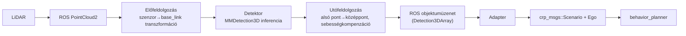

# AEB Perception - Követelmény- és interfészspecifikáció

Ez a dokumentum rögzíti, mit épít a csapat, milyen bemenetet és kimenetet vár a
perception-lánc, és hogyan illeszkedik a tavalyi `braking_system`-hez. Minden
**[TBD]** jelölésű pont csapatdöntést igényel - ezeket a 2. szekció alján
kérdésként is összegyűjtöttem.

## 1. Feladat és hatókör

LiDAR pontfelhő → előfeldolgozás → neurháló-detektor → utófeldolgozás →
ROS-objektumüzenet → adapter → `behavior_planner`.

**Kezdő hatókör (M1–M2):**

- Osztályok: **autó** (1 osztály). Bővítés később: gyalogos, kerékpáros.
- Csak a `behavior_planner` jelenlegi igényét szolgáljuk ki: az objektum
  pozíciója és abszolút (ego-kompenzált) sebessége a `base_link` frame-ben.

## 2. Rendszerparaméterek

| Paraméter               | Érték                                                     | Megjegyzés                                                                                   |
| ----------------------- | --------------------------------------------------------- | -------------------------------------------------------------------------------------------- |
| Osztályok               | autó (`label = 1`, autoware enum)                         | lásd 4. szekció                                                                              |
| Érzékelési tartomány    | **[TBD]** pl. 0–50 m előre, ±10 m oldalra                 | a `behavior_planner` `critical_distance` paramétere 200 (egység tisztázandó - lásd kérdések) |
| LiDAR-topic             | **[TBD]**: `/luminar_pcl` vagy `/lexus3/os_center/points` | a kettő nem keverhető kalibráció nélkül - 1.8-as task dönti el                               |
| Ego-odometria topic     | `/novatel/oem7/odom`                                      | rögzített, a wiki szerint                                                                    |
| Frame-ek                | szenzor-frame → `base_link` transzformáció kötelező       | a kimenet mindig `base_link`-ben                                                             |
| Feldolgozási gyakoriság | **[TBD]** pl. 10 Hz                                       | a LiDAR natív mérési gyakoriságától függ                                                     |
| Megengedett késleltetés | **[TBD]** pl. max 150 ms                                  | a `behavior_planner` `publish_rate` paramétere 50 Hz                                         |

---

## 3. Kimeneti szerződés - a detektor node kimenete

A perception node **ROS-standard üzenetet** publikál, nem a planner egyedi
formátumát. Ez RViz-ben, rqt-ben és bármely általános ROS eszközzel
vizsgálható, és független marad a `behavior_planner` belső reprezentációjától.

**Topic:** `/perception/detections`

**Típus:** `vision_msgs/Detection3DArray`

| Mező                                           | Tartalom                                                                                                                                                                                                                                                                     |
| ---------------------------------------------- | ---------------------------------------------------------------------------------------------------------------------------------------------------------------------------------------------------------------------------------------------------------------------------- |
| `header.stamp`                                 | a bemeneti pontfelhő mérési ideje (nem az inferencia ideje)                                                                                                                                                                                                                  |
| `header.frame_id`                              | `base_link`                                                                                                                                                                                                                                                                  |
| `detections[i].bbox.center`                    | x, y, z - a doboz **geometriai középpontja** (az MMDetection3D alapértelmezetten alsó bbox-pontot ad, ezt át kell számolni)                                                                                                                                                  |
| `detections[i].bbox.size`                      | hossz, szélesség, magasság (méterben)                                                                                                                                                                                                                                        |
| `detections[i].bbox.center.orientation`        | yaw, quaternionná alakítva                                                                                                                                                                                                                                                   |
| `detections[i].results[0].hypothesis.class_id` | osztály (`"car"`)                                                                                                                                                                                                                                                            |
| `detections[i].results[0].hypothesis.score`    | detekciós konfidencia                                                                                                                                                                                                                                                        |
| _(kiterjesztés szükséges)_ `vx`, `vy`          | abszolút, ego-mozgással kompenzált sebesség - a `vision_msgs/Detection3D` alapból nem tartalmaz sebességet, ezért vagy egyedi mezőt kell hozzáadni, vagy a `vision_msgs/BoundingBox3D` helyett `autoware_perception_msgs/DetectedObject`-et használni **[TBD, döntés kell]** |
| `ax`                                           | opcionális, ha nincs mérve, 0                                                                                                                                                                                                                                                |

---

## 4. Adapter - fordítás a `behavior_planner` formátumára

A `braking_system` tavalyi szimulátorának forráskódjából (`simulator.cpp`)
pontosan kiolvasható, mit vár a planner. Az adapter node (1.6-os task) ezt a
leképezést végzi:

**Kimeneti topicok és típusok:**

- `crp_msgs::msg::Scenario` → `local_moving_objects.objects`: lista
  `autoware_perception_msgs::msg::PredictedObject` elemekből
- `crp_msgs::msg::Ego`

**Mezőleképezés (`Detection3DArray` → `Scenario.local_moving_objects`):**

| Forrás (`Detection3DArray`)          | Cél (`PredictedObject`)                                                        |
| ------------------------------------ | ------------------------------------------------------------------------------ |
| `header.frame_id` (`base_link`)      | `Scenario.header.frame_id = "base_link"`                                       |
| `bbox.center.position.x/y`           | `kinematics.initial_pose_with_covariance.pose.position.x/y`                    |
| `bbox.center.orientation` (yaw-ból)  | `kinematics.initial_pose_with_covariance.pose.orientation`                     |
| osztály (`"car"`)                    | `classification[0].label = 1` (autoware enum: 1=autó, 2=teherautó, 7=gyalogos) |
| `vx`                                 | `kinematics.initial_twist_with_covariance.twist.linear.x`                      |
| `ax` (opcionális, alapértelmezett 0) | `kinematics.initial_acceleration_with_covariance.accel.linear.x`               |

**`Ego` üzenet** (`/novatel/oem7/odom`-ból):

| Forrás               | Cél (`crp_msgs::msg::Ego`) |
| -------------------- | -------------------------- |
| pozíció x            | `pose.pose.position.x`     |
| sebesség             | `twist.twist.linear.x`     |
| gyorsulás            | `accel.accel.linear.x`     |
| yaw                  | `orientation`              |
| kormányszög (ha van) | `tire_angle_front`         |

**Fontos, a `trajectoryCalculation.cpp` alapján:** a `behavior_planner` a
relatív sebességet `dv = ego_v − obj_v` képlettel számolja, tehát az objektum
sebessége **ugyanabban a (abszolút, globális irányú) rendszerben** kell
legyen, mint az ego sebessége. Ezért kell a detektor kimenetén az
ego-mozgással kompenzált `vx`, nem a szenzorhoz képesti relatív sebesség.

---

## 5. Adatfolyam-ábrák

### Tanítás

### Élő működés

---

## 6. Nyitott kérdések a csapatnak

Ezeket a következő csapatmegbeszélésen el kell dönteni, mielőtt az 1.5-ös
(Perception node váz) task elindul:

1. **LiDAR-topic:** `/luminar_pcl` vagy `/lexus3/os_center/points`? (1.8-as
   task felderíti, melyik adat érhető el ténylegesen a Drive-on.)
2. **Érzékelési tartomány és Hz:** a `behavior_planner` `critical_distance`
   paramétere 200 - méterben vagy más egységben? Ezt mi nem tudjátok előre kitalálni, csak megmérni: a LiDAR Hz-ét a szenzor adatlapja vagy a rögzített mérés (1.8-as task) adja meg, a detektor tényleges feldolgozási sebességét pedig csak azután tudjátok megmérni, hogy a modell fut a ti hardveretken (ez a 1.3-as, majd később a 3.4-es task). Most csak egy célértéket érdemes beírni (pl. "szeretnénk legalább 5 Hz-et elérni"), amit majd a mérés igazol vagy cáfol.
3. **Sebesség a kimeneti üzenetben:** `vision_msgs/Detection3D` natívan nem
   tartalmaz sebességmezőt. Vagy egyedi mezőkiterjesztés, vagy áttérés
   `autoware_perception_msgs/DetectedObject`-re már a detektor szintjén (ez
   konzisztensebb lenne az adapter célformátumával, de kevésbé "ROS-standard"
   vizualizációhoz).
4. **ROS 2 disztró:** melyiket használja a `braking_system`? Ez határozza meg,
   kompatibilis-e közvetlenül az MMDetection3D devcontainer Python
   3.10-zel, vagy külön konténer kell (1.4-es task spike-ja dönti el).
5. **Sweep-puffer vagy egysweepes konfig:** a CenterPoint checkpoint 10
   sweepre lett tanítva. Éles ROS-ban honnan jön a 10 sweep (puffer +
   ego-kompenzáció), vagy single-sweep configra váltunk? (1.5-ös task.)
   -> Elsőnek sztem elég az egysweepes változat, hogy átlássuk utána lehet komplikálni.
